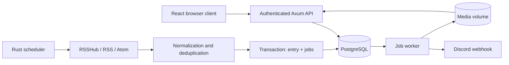

# Architecture

## Consistency and scheduling

`entries(feed_id, guid)` and `jobs(entry_id, kind)` are unique. Entries and their jobs are written in the same transaction. The first import does not queue historical notifications or downloads. The feed's `initialized` state changes only when the transaction commits. Changes to an already known identifier do not create another entry.

The scheduler checks every 10 seconds and holds a PostgreSQL session advisory lock throughout each processing cycle, releasing it before sleeping. The lock reserves one connection from a pool of 10. Additional application instances sharing the database cannot process the same cycle simultaneously. They must also share the media volume to serve downloaded files consistently.

Jobs transition through `pending`, `processing`, `done`, and `failed`. Reservation is atomic using `FOR UPDATE SKIP LOCKED`. Interrupted jobs are recovered after 15 minutes. Each execution has a 10-minute timeout; feed and media requests have a 90-second timeout.

Recoverable errors return to the queue with exponential backoff up to one hour. HTTP 429 uses `retry_after`, capped at 24 hours. The eighth failed attempt leaves the job failed until manually retried. Global notification/download switches pause the corresponding queue without deleting work.

Manual Discord requests lock the entry and settings while creating or resetting the job. Concurrent requests cannot create duplicate deliveries. A pending or processing job returns 409; a completed or failed job can be replayed.

Discord delivery is at least once. A lost response after an accepted message can cause a duplicate on retry. Local deduplication prevents duplicate job records but cannot eliminate uncertainty at the remote service.

## Media

Media URLs come from enclosures, Media RSS, and HTML `img`, `video`, and `source` elements. Relative URLs are resolved against the post URL. Duplicates are removed while preserving order, with at most 30 media items per post. Remote HTML is never inserted into the DOM; descriptions are plain text.

Downloads use UUID filenames and extensions derived from an allowed MIME type list: JPEG, PNG, GIF, WebP, AVIF, MP4, WebM, and QuickTime. Content streams into a `.part` file under a byte limit, is synchronized and renamed, then recorded in PostgreSQL. Normal errors remove partial files. Abrupt termination can leave orphaned files; retention is operator-managed.

Deleting a feed removes related database records while preserving files. The file-size limit is not a total disk quota.

## Trust boundaries

The API requires the owner key through an HttpOnly cookie or Bearer token. Cookies use `SameSite=Strict`; HTTPS deployments should enable `COOKIE_SECURE=true`. There is no permissive CORS policy or multi-user account model.

The HTTP client accepts HTTP(S), rejects URL credentials, limits response size and duration, resolves and validates DNS addresses, and pins them for each connection. Every redirect is revalidated. Private hosts are allowed only for feeds explicitly permitted by the operator; media requests have no such exception.

Webhooks are restricted to `https://discord.com/api/webhooks/...`. HTTP errors do not persist the secret URL. The webhook remains in PostgreSQL but is never returned in API responses. Discord payloads disable mentions and include up to four images with separate video links.

The frontend loads remote images with `referrerPolicy=no-referrer` and opens external links with `rel=noreferrer`. Content availability remains dependent on upstream platforms.
